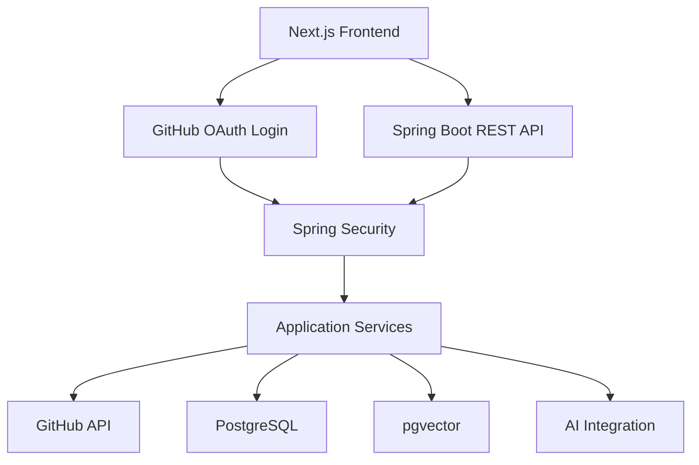

# GitCrawler — Backend

<p align="center">
  <strong>Backend Services for AI-Powered GitHub Repository Intelligence</strong>
</p>

<p align="center">
  A Java and Spring Boot backend for GitHub authentication, repository management, AI-assisted codebase exploration, and persistent application data.
</p>

<p align="center">
  
  
  
  
  
</p>

---

## Overview

GitCrawler Backend powers the server-side functionality of GitCrawler, an AI-powered GitHub repository intelligence platform.

Built with Java and Spring Boot, it provides the foundation for authentication, GitHub repository integration, application APIs, data persistence, and AI-assisted repository workflows.

The backend uses Spring Security for authentication and authorization, PostgreSQL for relational data, and pgvector for vector-based retrieval capabilities.

## Key Capabilities

- **GitHub OAuth 2.0** — Authenticate users through GitHub.
- **Session-Based Authentication** — Maintain authenticated sessions using server-managed security and cookies.
- **Repository Integration** — Connect application workflows with the GitHub API.
- **Repository Synchronization** — Support repository discovery and synchronization workflows.
- **AI Integration** — Provide backend services for repository-oriented AI features.
- **Vector Storage** — Use PostgreSQL with pgvector for embedding storage and similarity-search workloads.
- **Persistent Data** — Store application and repository-related information in PostgreSQL.
- **Security Controls** — Centralize authentication, authorization, and cross-origin request configuration.

The precise API surface and supported workflows depend on the current implementation.

## Tech Stack

| Technology | Purpose |
|---|---|
| Java 21 | Backend programming language |
| Spring Boot | Application framework |
| Spring Web | REST API development |
| Spring Security | Authentication and authorization |
| Spring OAuth2 Client | GitHub OAuth integration |
| Spring Data JPA / Hibernate | Relational persistence |
| PostgreSQL | Primary relational database |
| pgvector | Vector storage and similarity search |
| Spring AI | AI integration, where configured |
| Maven | Build and dependency management |
| Docker Compose | Local database infrastructure |

## Architecture



### Request Flow

1. A user signs in through GitHub OAuth.
2. Spring Security handles the OAuth flow and establishes the authenticated session.
3. The frontend sends authenticated requests to the backend.
4. Controllers delegate business operations to application services.
5. Services interact with GitHub, PostgreSQL, and configured AI components as required.

## Prerequisites

Install the following before running the backend:

- Java Development Kit (JDK) 21
- Maven, or the project's Maven Wrapper
- Docker and Docker Compose
- A GitHub OAuth App
- Access to any AI provider configured for the project

## Getting Started

### 1. Clone the repository

```bash
git clone https://github.com/devch105/gitcrawler-backend.git
cd gitcrawler-backend
```

### 2. Configure PostgreSQL with pgvector

If the repository contains the database Docker Compose configuration, start it with:

```bash
docker compose up -d
```

The local development configuration has used the following connection settings:

| Setting | Value |
|---|---|
| Database | `gitcrawler` |
| Host port | `5433` |
| Container port | `5432` |
| JDBC URL | `jdbc:postgresql://localhost:5433/gitcrawler` |

Use the actual credentials and service names defined in your local Compose and application configuration. Never commit production credentials.

### 3. Configure environment variables

Configure the variables required by your Spring Boot application. The following names are examples; map them to the property names used by your configuration.

```env
GITHUB_CLIENT_ID=your_github_oauth_client_id
GITHUB_CLIENT_SECRET=your_github_oauth_client_secret

DB_URL=jdbc:postgresql://localhost:5433/gitcrawler
DB_USERNAME=your_database_username
DB_PASSWORD=your_database_password

FRONTEND_URL=http://localhost:3000
```

If your application uses Spring AI or an external embedding provider, configure its required model and provider credentials separately.

Do not commit `.env` files, OAuth secrets, AI provider keys, or database passwords.

### 4. Configure GitHub OAuth

Create a GitHub OAuth App in your GitHub Developer Settings.

Configure the callback URL to match the backend's registered OAuth callback route. For the standard Spring Security OAuth2 client configuration, the local callback is typically:

```text
http://localhost:8080/login/oauth2/code/github
```

The authorization flow normally starts at:

```text
http://localhost:8080/oauth2/authorization/github
```

Ensure the callback, frontend redirect, and application properties match your actual configuration.

### 5. Run the backend

Using the Maven Wrapper on Linux or macOS:

```bash
./mvnw spring-boot:run
```

On Windows:

```powershell
.\mvnw.cmd spring-boot:run
```

Alternatively, with Maven installed:

```bash
mvn spring-boot:run
```

The backend will typically be available at [http://localhost:8080](http://localhost:8080), unless the configured server port differs.

## Build and Test

```bash
./mvnw clean test
./mvnw clean package
```

Run the packaged application using the generated JAR:

```bash
java -jar target/*.jar
```

## Project Structure

```text
gitcrawler-backend/
├── src/
│   ├── main/
│   │   ├── java/
│   │   │   └── .../
│   │   │       ├── config/        # Application and security configuration
│   │   │       ├── controller/   # HTTP controllers
│   │   │       ├── service/      # Business logic
│   │   │       ├── repository/   # Data access
│   │   │       ├── entity/       # Persistence models
│   │   │       └── ...           # Additional packages
│   │   └── resources/
│   │       └── application.yaml
│   └── test/
├── docker-compose.yml
├── pom.xml
├── mvnw
├── mvnw.cmd
└── README.md
```

This is a conceptual layout. Retain the package names and directories that actually exist in the repository.

## API and Security

The backend is responsible for:

- Handling GitHub OAuth authentication.
- Protecting application endpoints.
- Managing authenticated user sessions.
- Validating frontend origins and credentialed requests.
- Exposing repository and chat-related APIs implemented by the application.
- Managing persistence and backend integrations.

For local development, configure CORS for the frontend origin, commonly `http://localhost:3000`. For production, allow only the intended frontend origins and configure session cookies appropriately for the deployment environment.

Do not disable authentication or CSRF protections globally as a workaround for cross-origin issues. Configure the applicable security rules for the actual authentication model.

## Deployment

The backend can be deployed to a Java-compatible hosting platform such as Render.

Before deployment:

1. Provision a PostgreSQL database with the required pgvector support.
2. Set production database connection properties.
3. Configure GitHub OAuth credentials and the correct callback URL.
4. Set the production frontend URL and allowed CORS origins.
5. Configure required AI provider credentials and model settings.
6. Verify session-cookie behavior over HTTPS.
7. Run database initialization and migration steps appropriate to the project.
8. Review application logs and verify the authentication and repository workflows.

Never expose OAuth client secrets or database credentials in frontend variables or public repository files.

## Related Repository

- **Frontend:** [GitCrawler Frontend](https://github.com/devch105/gitcrawler-frontend)

## Contributing

1. Fork the repository.
2. Create a feature branch.
3. Implement and test your changes.
4. Submit a pull request with a clear description.

## License

Add the project's actual license here. Do not claim MIT licensing unless the repository includes the corresponding license.
